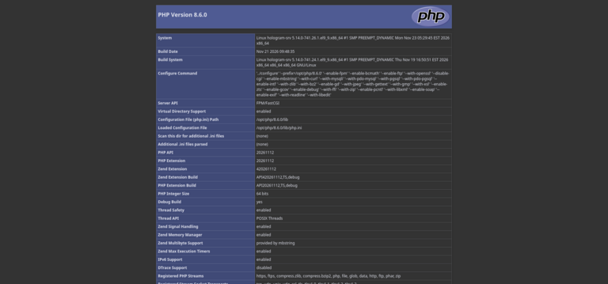

# hologram-php86

**Here are the procedures for obtaining a LAMP server stack with version 8.6 of PHP thanks to the distribution AlmaLinux 9.9**

The following command was used to reduce the size of the following screenshot:

```shell
convert PHP_8.6.0_phpinfo_screenshot.png -resize 40% PHP_8.6.0_phpinfo.png
```



The following command is used to obtain information about the system in use:

```shell
hostnamectl
```

---

## summary

0. Simulate DNS resolution for a virtual environment by configuring the `/etc/hosts` file.

1. These files document configuring host-based DNS resolution and post-installation system hardening, including package setup and firewall management, SELinux configuration and port verification.

2. This guide covers securing SSH access via public key authentication and disabling password logins, while configuring VS Code for SFTP-based development and bare repository workflows.

3. This document outlines the installation and security setup of MariaDB, along with procedures for managing user accounts, including granting host-specific privileges, revoking access and dropping users.

4. This guide outlines the installation, initialization and user configuration of PostgreSQL, including steps to enable remote network access and verify connectivity.

5. This document provides a step-by-step guide for connecting to a PostgreSQL server, creating a new database and setting up multiple schemas and tables using SQL commands.

6. This guide details the installation, initialization and network configuration of PostgreSQL 17 on Linux, along with remote access verification and backup procedures.

7. This guide details the end-to-end workflow of preprocessing a CSV file, provisioning a PostgreSQL database, importing data via `\copy` and cloning a table into a new schema.

8. This document provides a step-by-step guide to configuring HTTPS on an Apache web server using a self-signed SSL certificate and virtual host redirection.

9. This document outlines the installation of essential build tools and PHP compilation dependencies on an AlmaLinux system using the DNF package manager.

10. This document provides a step-by-step guide to compiling PHP 8.6.0 from source, configuring PHP-FPM and integrating it with Apache 2.

11. Compiling PHP 8.6.0 from source, configuring PHP-FPM and integrating with Apache 2, with key differences including added support for PostgreSQL, SOAP, EXIF, PCNTL, libxml, readline and libedit optimized for an LMS, CMS, or bespoke enterprise management and accounting platform-alongside increased resource limits (512M memory, 600s timeout, 250M upload size) and explicit Opcache/session tuning compared to the previous version.

12. This guide provides a step-by-step walkthrough for compiling Xdebug from source, configuring PHP and VS Code for remote debugging and verifying the setup with a test script.

13. This guide details how to install ImageMagick from source on AlmaLinux, build the PHP Imagick extension and configure PHP to load it.

14. This guide explains how to install, verify and update Composer globally on Linux, along with troubleshooting commands.

15. This document outlines the steps to compile Node.js from source, install global dependencies like TypeScript and Angular and manage updates using the `n` package.

16. This document provides a step-by-step guide to setting up a Laravel web application named "opificium," including Apache SSL configuration, Ollama LLM integration via the Prism package and the installation of development tools like Livewire, Pest and Pint.

17. This document outlines the steps to scaffold a Laravel application and configure a secure Apache virtual host with SSL for the `knowledge.local` domain.

18. This document describes configuring an Apache virtual host with SSL for a vanilla PHP web application named "normalize", covering certificate generation, configuration and deployment steps.

19. How to install and configure the Go programming language on a Linux system.

20. How to install and configure the Ollama server on Linux to run and access large language models locally.
